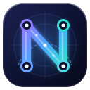

<div align="center">



# Nikatel panel

**One control panel for a tunnel-based network** — Iranian and foreign servers, the tunnels between them,
client configs tested from inside Iran, Marzban / PasarGuard panels, a Telegram shop bot and its Mini App.

[](https://github.com/hamed67vi/nikatel-panel/actions)


[Features](docs/features.md) · [Tunnels](docs/tunnels.md) · [Shop bot](docs/shop-bot.md) · [Operations](docs/operations.md) · [Security](SECURITY.md) · [Architecture](ARCHITECTURE.md) · [Changelog](CHANGELOG.md)

</div>

---

## Contents
1. [What it is](#what-it-is) · 2. [Install](#install) · 3. [What it does](#what-it-does) · 4. [Tunnels](#tunnels) · 5. [Configs and panels](#configs-and-panels) · 6. [Shop bot and Mini App](#shop-bot-and-mini-app) · 7. [Alerts, reports, backups](#alerts-reports-backups) · 8. [How it is built](#how-it-is-built) · 9. [Security](#security) · 10. [Documentation](#documentation) · 11. [Status](#status)

## What it is

A clean rebuild of an earlier single-file panel, written to be **read, tested, operated and extended**. It watches
a fleet of servers and tunnels, tells you the moment something breaks, repairs what it safely can, builds new
tunnels from the browser, keeps client configs alive and measured from inside Iran, manages the Marzban /
PasarGuard panels behind them, and runs the Telegram shop that sells the service.

The one rule it was built around: **a tunnel users depend on must never go down because of the panel.**
It only touches servers over SSH, only through a fixed list of reviewed scripts, and every change is
dry-runnable, logged and rate-limited.

## Install

One line, Debian / Ubuntu, as root:

```bash
curl -fsSL https://raw.githubusercontent.com/hamed67vi/nikatel-panel/main/install.sh | bash
```

It asks for the port, an optional domain (Let's Encrypt) and the admin password, installs what is missing and
starts the panel on `https://<server>:9443`. Run it again to upgrade. Non-interactive:
`curl … | bash -s -- --yes --port 9443`. Upgrades afterwards are one click in **Settings → Update**
(pull, tests, restart, health check, automatic rollback). Details: [`docs/operations.md`](docs/operations.md).

| Requirement | |
|---|---|
| Panel server | Debian / Ubuntu, Python 3.10+, root, outbound internet |
| Managed servers | SSH with the panel's own key (installed once with the server's password), systemd |
| Shop bot (optional) | the PHP bot with MariaDB on its own server; the panel administers it over SSH |

## What it does

| Area | In one line |
|---|---|
| **Dashboard** | health of everything, only the problems that exist *now*, one-click *Fix with AI* / *Fix all*, the event feed |
| **Nodes** | Iran and foreign servers: CPU, RAM, disk, load, traffic every 2 minutes, 24 h charts, console, tools, the Iran gateway |
| **Tunnels** | build, monitor every minute, alert, repair, test, update — five engines, 24 transports |
| **Panels** | client configs on the probe (ping, speed, history, subscriptions) and the Marzban / PasarGuard panels (users, hosts, nodes, outbounds) |
| **Shop bot** | payments, orders, users, plans, categories, discounts, gift codes, broadcast, tickets, every text and switch |
| **Mini App** | the customers' Telegram app: buy, renew, top up, tickets, referral |
| **Settings** | account with two-step sign-in, alerts, encrypted backups, probe, repairs and AI, appearance, one-click update |

Everything is listed page by page in [`docs/features.md`](docs/features.md).

## Tunnels

Five engines, all built, monitored, tested and repaired from the panel
(full catalogue with every transport: [`docs/tunnels.md`](docs/tunnels.md)):

| Engine | Direction | Transports | Use it for |
|---|---|---|---|
| **Backhaul over GRE** | foreign → Iran | TCP Mux ★, TCP, WebSocket Mux, WebSocket TLS Mux | the default — stable, many users over few connections |
| **BackPack** | foreign → Iran | TCP Mux, TCP, Stealth, PCK, UDP + KCP + FEC, UDP, QUIC, WebSocket (plain / Mux / TLS / TLS Mux), xDi (ICMP) | heavy filtering, lossy or throttled routes |
| **BackPack Direct** | Iran → foreign | UDP, QUIC, PCK, SNI spoofing, xDi (ICMP) | routes where the foreign server cannot be dialled |
| **Paqet** | Iran opens the ports | KCP over raw sockets | routes that stall ordinary TCP |
| **Chisel** | foreign → Iran | HTTP WebSocket, TLS WebSocket | where only HTTP(S)-looking traffic passes |

What happens to each tunnel:

* **Build** — preflight of both servers, port and network allocation, engine install (verified download), configs and units on both sides, two-way and data-path proof, **rollback of everything on failure**.
* **Monitor** — every minute: units on both sides, carrier interface, 20 pings, forwarded ports, one real HTTP request through the tunnel; state changes need two agreeing checks so a single lost packet never flaps.
* **Repair** — the *Tunnel Doctor* diagnoses both ends, restarts only what is broken (Iran first), rebuilds (safely: the old tunnel comes back when the new build fails), tests a fresh GRE link *beside* the tunnel before it replaces anything, tries another transport and tells you when only a move to another Iran server helps. *Fix with AI*, *Fix all*, *Explain*, a network advisor that ranks every type on today's network, auto-repair with limits (2 plain restarts per tunnel per hour, a smart repair every half hour, never when a server is off, never in a storm).
* **DNS · IP switch** — the A records of your ArvanCloud account with the panel server each one points at; point a record at another Iran server with one click (users follow within the record's TTL), every change listed with a *Restore*. The failover of a dead Iran server - or one whose route is useless while it still answers and no other tunnel type works - moves its tunnels and records to another Iran server, with your approval first or by itself. Changing a server's address in Servers rebuilds its tunnels and moves its records too.
* **Test** — builds a temporary tunnel per chosen transport (22 kinds in 5 groups), measures latency, jitter, loss and download speed, scores 0–100, removes it and compares them in one table. All 14 kinds of the default catalogue were built and measured for real on one pair of servers (2026-10-12, see the changelog of 1.19.0).
* **Change** — edit forwarded ports, rebuild, remove, adopt tunnels already running on the servers, update Backhaul / Xray on every server.

## Configs and panels

**Configs on the probe** — a small service inside Iran keeps one Xray per client config alive and measures it from
there: status, ping (green < 800 ms, yellow 800–999, red above), daily speed test, 24 h history. Groups per
subscription (import, sync, pick which nodes stay, categories), inline tunnel and CDN port, a v2rayN-style editor,
test all / delete all, direct configs judged by TCP reachability from Iran and CDN-fronted ones by name (SNI) as well.
Primary probe plus standbys with automatic failover; one-click probe installer for any Iran server.

**Marzban / PasarGuard** — status every 2 minutes, nodes with automatic reconnect and logs, users (search, status
filter, a full edit window, bulk disable / enable / renew), hosts (edit, clone, disable), the Xray core's
outbounds with backup, validation and automatic rollback, and a small test user per panel whose subscription is kept
alive on the probe.

**Iran gateway** — a plain Xray pushed to an Iran server over SSH: ports forwarded to foreign nodes, borrowed
vless / vmess / trojan / ss configs as the way out during internet cuts, modes auto / borrowed / direct, exit test per config.

## Shop bot and Mini App

The PHP shop bot runs on its own server; the panel administers it through reviewed scripts
([`docs/shop-bot.md`](docs/shop-bot.md)) and installs its Mini App ([`bot/miniapp/`](bot/miniapp/README.md)).

| Shop bot pages | Mini App (Persian, follows the Telegram theme) |
|---|---|
| Payments to confirm with ✅ / ❌ (wallet credited like the bot) | Services with live usage from the panel |
| Orders, users (wallet, discount, agent, ban, message) | Buy from the wallet — account created on the plan's panel |
| Plans (quick add: category, server, time, volume, price), categories | Renew, extra volume, extra days |
| The panels it sells from, discount codes, gift codes | Card-to-card top-up, receipt sent to the admins with the bot's own buttons |
| Broadcast, tickets with reply | Payment history, cashback, gift codes, lucky wheel |
| Every text and button (overrides), every switch, payment keys | Tickets, referral link, connection apps, outage reports |
| Apps list, top-up prices, backups, tables, read-only SQL, stats, webhook, command menu, import | Deep links, live QR for subscriptions |

## Alerts, reports, backups

* **Alerts (Telegram)** — one DOWN after N failed checks *and* a minimum down time, one UP after a stable period, reminders optional, a FLAPPING notice then silence for things that bounce; mute per item; maintenance windows.
* **Daily report** at a chosen local hour. **Encrypted backups** (aes-256) kept locally and sent to Telegram, one-command restore.
* **Events and logs** — one plain sentence per thing that happened, categories and filters; the panel's own log with request ids and masked secrets.

## How it is built

```
 browser ── HTTPS ──► panel (FastAPI + SQLite) ── SSH (own key, reviewed scripts) ──► Iran servers, foreign servers
 Telegram ◄── alerts ─┘      │                                                         (tunnels = systemd services)
                             ├── HTTPS ──► Marzban / PasarGuard panels ── probe API ──► probe inside Iran
                             └── SSH ──► shop bot server (PHP bot + MariaDB + Mini App) ◄── Telegram ◄── customers
```

One Python process with SQLite (WAL, numbered migrations). The UI is three files with no build step
(`index.html`, `app.css`, `app.js`, one function per page). Layers call downward only (`api → services → db / ssh`),
parsing and judging are pure functions with tests, every network call has a timeout, jobs never die. Full map:
[`ARCHITECTURE.md`](ARCHITECTURE.md). 160+ tests, ruff, JS and shell syntax checks and a secrets scan run in CI.

## Security

One admin, scrypt password hash, signed Secure cookie (also behind a TLS proxy), optional TOTP two-step sign-in with
recovery codes, an optional secret entry path, a Content-Security-Policy, session-only API docs. SSH only through named
read-only **scripts** and reviewed **actions** with regex-validated parameters; actions are refused in read-only mode.
The shop bot's token and database password never leave the bot server; the Mini App verifies Telegram's signature on
every request. The repository contains **no addresses, names or credentials of any real infrastructure** — a scanner
blocks them on every commit and in CI. Details and what to do when something is wrong: [`SECURITY.md`](SECURITY.md).

## License tiers

The panel runs in one of three modes (Settings → About → License): **owner** (`NIKATEL_LICENSE=owner`, everything),
**licensed** (a signed `NK1.` token, Ed25519, bound to an install or floating) and the **free tier** (Backhaul TCP Mux
tunnels and every read-only page). The features a token switches on: `tunnels` (every engine), `ai`, `failover`
(ArvanCloud DNS), `shopbot`. What the check in the panel does and does not protect, and the license server that
carries the real weight (metered AI, releases): [`docs/licensing.md`](docs/licensing.md).

## Documentation

| | |
|---|---|
| **Use it** | [`docs/features.md`](docs/features.md) page-by-page features · [`docs/tunnels.md`](docs/tunnels.md) every tunnel engine and transport · [`docs/operations.md`](docs/operations.md) install, upgrade, back up, alerts, logs, the bot server · [`docs/shop-bot.md`](docs/shop-bot.md) · [`bot/miniapp/README.md`](bot/miniapp/README.md) |
| **Trust it** | [`SECURITY.md`](SECURITY.md) |
| **Change it** | [`ARCHITECTURE.md`](ARCHITECTURE.md) · [`docs/development.md`](docs/development.md) · [`docs/logging.md`](docs/logging.md) · [`docs/licensing.md`](docs/licensing.md) · [`docs/adr/`](docs/adr/) |
| **Follow it** | [`CHANGELOG.md`](CHANGELOG.md) · [`docs/roadmap.md`](docs/roadmap.md) · index [`docs/README.md`](docs/README.md) |

## Status

**1.19 — milestones M0–M8 done, M9 in progress.** Everything the old panel did, in the new structure, plus the shop bot
run entirely from the panel (rebuilt page by page from its designs), a Telegram Mini App in the panel's glass look, the
DNS · IP switch, the license tiers and a real run of every tunnel kind. Open in M9: the license server and AI proxy, the
language switch of the remaining strings, a split of `app.js` into one file per page.

## The way forward

Stable first, API-first, features later: [docs/engineering-plan.md](docs/engineering-plan.md). New ideas are parked in the roadmap (milestone M11) and built only after milestone M10.
